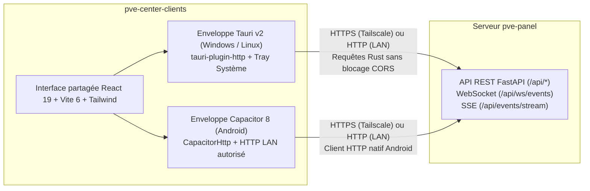

[English](README.md) | [Français](README.fr.md)

<div align="center">
  
  <h1>PVE Command Center — Clients Multiplateformes</h1>
  <p>
    <strong>Applications Desktop (Windows &amp; Linux via Tauri v2) et Mobile (Android via Capacitor 8) pour PVE Command Center.</strong><br />
    React 19 &nbsp;•&nbsp; TypeScript &nbsp;•&nbsp; Vite 6 &nbsp;•&nbsp; Tailwind CSS &nbsp;•&nbsp; Tauri v2 &nbsp;•&nbsp; Capacitor 8
  </p>

  <p>
    
    
    
    <a href="LICENSE"></a>
  </p>

  <p>
    <a href="#aperçu">Aperçu</a> &nbsp;·&nbsp;
    <a href="#fonctionnalités">Fonctionnalités</a> &nbsp;·&nbsp;
    <a href="#desktop-windows--linux">Windows &amp; Linux</a> &nbsp;·&nbsp;
    <a href="#android">Android</a> &nbsp;·&nbsp;
    <a href="#écosystème-pve-command-center">Écosystème</a>
  </p>
</div>

---

## Aperçu

**PVE Command Center Clients** empaquette le tableau de bord Liquid Glass en applications natives pour :

- **Windows 10 / 11** (`x64`) — installeurs NSIS `.exe` et MSI `.msi` propulsés par **Tauri v2** (`io.github.pvepanel.desktop`).
- **Linux** (`x64`) — paquets `.AppImage` et `.deb` propulsés par **Tauri v2** et WebKitGTK 4.1.
- **Android** (`API 24+`, Android 7.0+) — APK / AAB générés via **Capacitor 8** (`io.github.pvepanel.app`).



---

## Fonctionnalités

- **Connexion à n’importe quel serveur PVE Command Center** : enregistrez l’URL Tailscale Serve (`https://...ts.net`) ou LAN (`http://192.168.x.x:8000`) via la fenêtre **Connexion Serveur**, tout en conservant le repli relatif `/api` lorsque l’interface est servie sur le Web.
- **Stockage chiffré des identifiants et jetons** : `src/lib/secureStorage.ts` chiffre au repos l’URL du serveur, les jetons API Bearer et les JWT de session via **WebCrypto AES-256-GCM** (`window.crypto.subtle`), avec migration transparente des entrées `localStorage` en clair et repli non bloquant sur HTTP LAN lorsque `crypto.subtle` est indisponible.
- **Sélecteur de nœuds Cluster Proxmox VE** : basculez entre la vue agrégée **Tous les nœuds (`*`)** et chaque nœud individuel (`?node=<nom>`), visualisez les alertes de **bascule automatique (failover)**, identifiez l’hôte de chaque VM/LXC et ciblez les commandes d’alimentation sur le nœud concerné.
- **Authentification DualAuth** : prise en charge du SSO Tailscale, du code **PIN Administrateur** (`AuthLoginModal`) et des jetons Bearer (`pve_...`).
- **Réseau natif sans blocage CORS** :
  - Sur Desktop, `@tauri-apps/plugin-http` (`tauri-plugin-http`) exécute les appels HTTP côté Rust.
  - Sur Android, `CapacitorHttp` et `android:usesCleartextTraffic="true"` permettent de joindre aussi bien les adresses IP locales HTTP que Tailscale HTTPS.
- **Télémétrie temps réel** : flux WebSocket (`/api/ws/events`) avec reconnexion exponentielle et bascule automatique en Server-Sent Events (`/api/events/stream`).
- **Icône dans la zone de notification (Desktop)** : clic gauche pour afficher/masquer la fenêtre, ou menu natif (*Show PVE Center*, *Hide to Tray*, *Quit*).
- **Mode Démo interactif** : testez toute l’interface (nœud Proxmox VE, LXC/VM, stockage SMART/MergerFS, Opérations, Utilisateurs, Incidents, éditeur YAML et assistant d’installation) sans serveur actif.

---

## Desktop (Windows & Linux)

Guide complet : [Guide Desktop Windows & Linux](docs/fr/desktop-guide.md)

### Prérequis

- **Node.js 22+** et **npm**
- **Rust & Cargo** (`rustup` chaîne stable)
- **Paquets système Linux** (Debian/Ubuntu) :
  ```bash
  sudo apt-get update && sudo apt-get install -y \
    libwebkit2gtk-4.1-dev libayatana-appindicator3-dev librsvg2-dev \
    libxdo-dev libssl-dev build-essential patchelf xdg-utils
  ```
- **Prérequis Windows** : Microsoft Edge WebView2 Runtime (inclus dans Windows 11 ; bootstrapper intégré à l’installeur) et Visual Studio C++ Build Tools.

### Développement & Compilation

```bash
npm install

# Fenêtre de développement avec rechargement à chaud
npm run tauri:dev

# Compilation des paquets Linux (.AppImage et .deb)
./scripts/build-desktop.sh
```

Sous Windows PowerShell :

```powershell
npm install
.\scripts\build-windows.ps1
```

---

## Android

Guide complet : [Guide Android Capacitor 8](docs/fr/android-guide.md)

### Prérequis

- **Node.js 22+** et **npm**
- **JDK 21** (Eclipse Temurin recommandé)
- **Android SDK** (`compileSdk 36`, `minSdk 24`) via Android Studio ou les outils CLI (`ANDROID_HOME`)

### Développement & Compilation

```bash
npm install

# Synchronisation des assets Web vers android/
npm run cap:sync

# Compilation d’un APK Debug
./scripts/build-android.sh

# Ou via script npm
npm run android:build
```

Les APK générés se trouvent dans `android/app/build/outputs/apk/`.

---

## Structure du projet

```text
pve-center-clients/
├── src/                        # Interface partagée React 19 + TypeScript + Tailwind
│   ├── components/             # Vues & modales (dont ProxmoxSection & ServerConfigModal)
│   ├── lib/apiClient.ts        # Détection plateforme, URL distante, fetch Tauri/Capacitor/Web & Mode Démo
│   ├── lib/secureStorage.ts    # Stockage chiffré WebCrypto AES-256-GCM des jetons & migration transparente
│   └── lib/realtimeClient.ts   # Client temps réel WebSocket + SSE
├── public/                     # Icônes PWA et manifeste
├── src-tauri/                  # Enveloppe Desktop Tauri v2 (Windows & Linux)
│   ├── src/                    # Point d’entrée Rust & System Tray natif
│   ├── capabilities/           # Permissions HTTP & Shell Tauri v2
│   ├── icons/                  # Icônes PNG, ICO, ICNS et AppX générées
│   ├── Cargo.toml
│   └── tauri.conf.json
├── android/                    # Projet natif Android Capacitor 8
├── scripts/                    # Scripts de build (Linux, Windows, Android)
├── docs/                       # Documentation bilingue (en / fr)
└── .github/workflows/          # Matrice CI Web, Linux, Windows et Android
```

---

## Écosystème PVE Command Center

| Dépôt | Description |
| --- | --- |
| [**PVE-Center/pve-panel**](https://github.com/PVE-Center/pve-panel) | Serveur FastAPI principal, supervision Proxmox/SMART, Alert Engine, Docker & `install.sh` |
| [**PVE-Center/pve-center-apple**](https://github.com/PVE-Center/pve-center-apple) | Applications natives Swift 6 / SwiftUI pour iOS, iPadOS, macOS et Apple TV (`tvOS`) |
| [**PVE-Center/pve-center-clients**](https://github.com/PVE-Center/pve-center-clients) | Clients multiplateformes Windows, Linux (Tauri v2) et Android (Capacitor 8) *(ce dépôt)* |
| [**PVE-Center/pve-center-website**](https://github.com/PVE-Center/pve-center-website) | Portail de documentation officiel et site vitrine |

---

## 🗺️ Feuille de route

- [x] UI partagée React 19 + TypeScript avec URL serveur dynamique, authentification Bearer et Mode Démo
- [x] Sélecteur de nœuds Cluster Proxmox VE (`?node=*` / par nœud, bannière failover et badges d’hôte sur les VMs/LXC)
- [x] Packaging Desktop Tauri v2 pour Windows (`.msi` / `.exe`) et Linux (`.AppImage` / `.deb`) avec icône barre système
- [x] Wrapper Android Capacitor 8 compatible LAN HTTP et HTTPS Tailscale + compilation CI Gradle
- [x] Stockage chiffré au repos des identifiants et jetons via WebCrypto AES-256-GCM (`src/lib/secureStorage.ts`) avec migration transparente et repli HTTP LAN
- [x] Publication automatisée des GitHub Releases sur les tags `v*` (`build-clients.yml` regroupant les artefacts Web, Windows, Linux et Android)
- [ ] Intégration trousseau OS natif (Tauri Stronghold / Android Keystore) et mises à jour signées (`tauri-plugin-updater`)

---

## Contribution & Sécurité

- Consultez [CONTRIBUTING.md](CONTRIBUTING.md) et le [Code de conduite](CODE_OF_CONDUCT.md) avant de soumettre une Pull Request.
- Pour signaler une faille de sécurité en privé, consultez [SECURITY.md](SECURITY.md).
- Distribué sous [Licence MIT](LICENSE).
