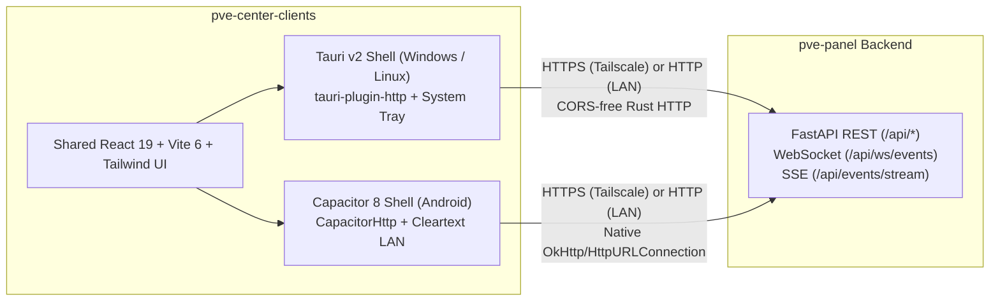

[English](README.md) | [Français](README.fr.md)

<div align="center">
  
  <h1>PVE Command Center — Multiplatform Clients</h1>
  <p>
    <strong>Desktop (Windows &amp; Linux via Tauri v2) and Mobile (Android via Capacitor 8) clients for PVE Command Center.</strong><br />
    React 19 &nbsp;•&nbsp; TypeScript &nbsp;•&nbsp; Vite 6 &nbsp;•&nbsp; Tailwind CSS &nbsp;•&nbsp; Tauri v2 &nbsp;•&nbsp; Capacitor 8
  </p>

  <p>
    
    
    
    <a href="LICENSE"></a>
  </p>

  <p>
    <a href="#overview">Overview</a> &nbsp;·&nbsp;
    <a href="#features">Features</a> &nbsp;·&nbsp;
    <a href="#desktop-windows--linux">Windows &amp; Linux</a> &nbsp;·&nbsp;
    <a href="#android">Android</a> &nbsp;·&nbsp;
    <a href="#ecosystem-repositories">Ecosystem</a>
  </p>
</div>

---

## Overview

**PVE Command Center Clients** packages the Liquid Glass dashboard UI into dedicated native applications for:

- **Windows 10 / 11** (`x64`) — NSIS `.exe` and MSI `.msi` installers powered by **Tauri v2** (`io.github.pvepanel.desktop`).
- **Linux** (`x64`) — `.AppImage` and `.deb` packages powered by **Tauri v2** and WebKitGTK 4.1.
- **Android** (`API 24+`, Android 7.0+) — APK / AAB powered by **Capacitor 8** (`io.github.pvepanel.app`).



---

## Features

- **Connect to any PVE Command Center server**: Save your Tailscale Serve (`https://...ts.net`) or local LAN (`http://192.168.x.x:8000`) server URL via the **Server Configuration** modal, with automatic fallback to relative `/api` when served as a web app.
- **Encrypted credential & token storage**: `src/lib/secureStorage.ts` encrypts persisted server URLs, Bearer API tokens, and session JWTs at rest using **WebCrypto AES-256-GCM** (`window.crypto.subtle`), automatically migrating legacy plaintext `localStorage` entries and degrading cleanly on plain LAN HTTP contexts where `crypto.subtle` is unavailable.
- **Multi-node Proxmox VE cluster switcher**: Switch between aggregated **Cluster (`*`)** telemetry and individual nodes (`?node=<name>`), view automatic **failover** alerts, inspect per-guest host badges, and send VM/LXC power commands to the guest's hosting node.
- **DualAuth support**: Works seamlessly with Tailscale SSO, Admin PIN login (`AuthLoginModal`), and Bearer API tokens (`pve_...`).
- **CORS-free native networking**:
  - Desktop uses `@tauri-apps/plugin-http` (`tauri-plugin-http`) so requests route through Rust rather than WebView CORS checks.
  - Android uses `CapacitorHttp` plus `android:usesCleartextTraffic="true"` so local HTTP homelab IPs and Tailscale HTTPS URLs both work out of the box.
- **Live telemetry**: Real-time WebSocket updates (`/api/ws/events`) with automatic exponential backoff and Server-Sent Events (`/api/events/stream`) fallback.
- **Native System Tray (Desktop)**: Left-click tray icon to show/hide the window, or use the native tray menu (*Show PVE Center*, *Hide to Tray*, *Quit*).
- **Interactive Demo Mode**: Explore the complete dashboard (Proxmox VE nodes/LXCs/VMs, MergerFS/SMART storage, Ops, Users, Incidents, YAML editor, and Setup Wizard) without a live backend.

---

## Desktop (Windows & Linux)

Detailed walkthrough: [Desktop Build & Usage Guide](docs/en/desktop-guide.md)

### Prerequisites

- **Node.js 22+** and **npm**
- **Rust & Cargo** (`rustup` stable toolchain)
- **Linux system packages** (Debian/Ubuntu):
  ```bash
  sudo apt-get update && sudo apt-get install -y \
    libwebkit2gtk-4.1-dev libayatana-appindicator3-dev librsvg2-dev \
    libxdo-dev libssl-dev build-essential patchelf xdg-utils
  ```
- **Windows prerequisites**: Microsoft Edge WebView2 Runtime (preinstalled on Windows 11; bootstrapper embedded in installer) and Visual Studio C++ Build Tools.

### Run & Build

```bash
npm install

# Development window (hot reload)
npm run tauri:dev

# Linux release packages (.AppImage and .deb)
./scripts/build-desktop.sh
```

On Windows PowerShell:

```powershell
npm install
.\scripts\build-windows.ps1
```

---

## Android

Detailed walkthrough: [Android Build & Usage Guide](docs/en/android-guide.md)

### Prerequisites

- **Node.js 22+** and **npm**
- **JDK 21** (Eclipse Temurin recommended)
- **Android SDK** (`compileSdk 36`, `minSdk 24`) via Android Studio or command-line tools (`ANDROID_HOME`)

### Run & Build

```bash
npm install

# Sync web build into android/
npm run cap:sync

# Build debug APK
./scripts/build-android.sh

# Or via npm script
npm run android:build
```

Generated APKs are placed under `android/app/build/outputs/apk/`.

---

## Project Structure

```text
pve-center-clients/
├── src/                        # Shared React 19 + TypeScript + Tailwind UI
│   ├── components/             # Dashboard views & modals (including ProxmoxSection & ServerConfigModal)
│   ├── lib/apiClient.ts        # Platform detection, remote base URL, Tauri/Capacitor/Web fetch & Demo Mode
│   ├── lib/secureStorage.ts    # WebCrypto AES-256-GCM credential/token storage & plaintext migration
│   └── lib/realtimeClient.ts   # WebSocket + SSE live event client
├── public/                     # PWA icons & manifest
├── src-tauri/                  # Tauri v2 desktop wrapper (Windows & Linux)
│   ├── src/                    # Rust entry point & native System Tray
│   ├── capabilities/           # Tauri v2 HTTP & shell permissions
│   ├── icons/                  # Generated PNG, ICO, ICNS, and AppX icons
│   ├── Cargo.toml
│   └── tauri.conf.json
├── android/                    # Capacitor 8 native Android project
├── scripts/                    # Helper build scripts (Linux, Windows, Android)
├── docs/                       # Bilingual documentation (en / fr)
└── .github/workflows/          # Matrix CI building Web, Linux, Windows, and Android
```

---

## Ecosystem Repositories

| Repository | Description |
| --- | --- |
| [**PVE-Center/pve-panel**](https://github.com/PVE-Center/pve-panel) | Core FastAPI server, Proxmox/SMART monitoring, Alert Engine, Docker & `install.sh` |
| [**PVE-Center/pve-center-apple**](https://github.com/PVE-Center/pve-center-apple) | Native Swift 6 / SwiftUI apps for iOS, iPadOS, macOS, and Apple TV (`tvOS`) |
| [**PVE-Center/pve-center-clients**](https://github.com/PVE-Center/pve-center-clients) | Cross-platform Windows, Linux (Tauri v2), and Android (Capacitor 8) clients *(this repo)* |
| [**PVE-Center/pve-center-website**](https://github.com/PVE-Center/pve-center-website) | Official documentation portal & landing site |

---

## 🗺️ Roadmap

- [x] Shared React 19 + TypeScript UI with dynamic server URL configuration, Bearer token auth & Demo Mode
- [x] Multi-node Proxmox VE cluster switcher UI (`?node=*` / per-node telemetry, failover alert banner & guest host badges)
- [x] Tauri v2 desktop wrapper for Windows (`.msi` / `.exe`) and Linux (`.AppImage` / `.deb`) with System Tray
- [x] Capacitor 8 Android wrapper with cleartext LAN + Tailscale HTTPS support & Gradle CI build
- [x] Encrypted at-rest credential & token storage via WebCrypto AES-256-GCM (`src/lib/secureStorage.ts`) with plaintext migration & plain HTTP fallback
- [x] Automated GitHub Release publishing on `v*` tags (`build-clients.yml` attaching Web, Windows, Linux & Android artifacts)
- [x] Native OS keychain / Credential Manager (`keyring` v3 on Windows/Linux/macOS + hardware-backed `AndroidKeyStore` Capacitor plugin) & signed `tauri-plugin-updater` auto-updates (`scripts/setup-updater-keys.sh`)

---

## Contributing & Security

- Please read [CONTRIBUTING.md](CONTRIBUTING.md) and our [Code of Conduct](CODE_OF_CONDUCT.md) before opening a pull request.
- To report a security issue privately, see [SECURITY.md](SECURITY.md).
- Released under the [MIT License](LICENSE).
